# LeadForge 🚀
### Autonomous Lead Scraping, Apollo-Grade Waterfall Enrichment, AI Icebreakers & Cold Outreach Platform

<div align="center">

[](https://github.com/Aryanban/leadforge)
[](https://opensource.org/licenses/MIT)
[](https://www.python.org/)
[](https://fastapi.tiangolo.com/)
[](https://nextjs.org/)
[](https://modelcontextprotocol.io/)
[](https://twenty.com/)
[-10b981.svg?style=for-the-badge&logo=pytest&logoColor=white)](https://github.com/Aryanban/leadforge)
[](https://www.docker.com/)

<br />

**A 100% self-hosted, full-stack B2B lead generation, waterfall contact enrichment, deliverability validation, and cold email outreach platform. Zero subscriptions. Zero per-lead API costs.**

[System Architecture](#-system-architecture) • [Feature Matrix & Cost Comparison](#-why-leadforge-cost--feature-comparison) • [Core Engineering Innovations](#-core-engineering-innovations) • [Technical Specifications](#-technical-specifications--engineering-decisions) • [Quickstart Guide](#-quick-start) • [Portfolio & Evaluation Showcase](#-engineering-portfolio--technical-evaluation-showcase)

</div>

---

## 📌 Executive Overview & Enterprise Problem Statement

Modern B2B revenue and agency teams spend thousands of dollars annually on SaaS data vendors (Apollo.io, Hunter.io, Lemlist, Outscraper) that gate public business data behind restrictive monthly credits. In addition to high per-lead fees, naive crawlers and sales automation tools suffer from critical engineering bottlenecks:
1. **Aggressive Anti-Bot Mitigation**: Traditional scraping scripts trigger IP bans, captchas, and bot challenges when traversing dense map nodes.
2. **Domain Reputation Destruction**: Outbound campaigns sent to unverified addresses or catch-all mail servers suffer severe bounce penalties (`550 User Not Found`), permanently burning sender domains.
3. **Obfuscated Contact Footprints**: Modern corporate websites utilize Cloudflare Email Obfuscation (`data-cfemail` XOR tokens) and anti-scraping text mutations (`[at]`, `[dot]`), defeating simple regex parsers.
4. **Generic AI Hallucinations**: Standard LLM outreach generators produce bland, templated pitches that trigger commercial spam filters.

**LeadForge** resolves these challenges through a unified, self-hosted autonomous architecture:
* **Turbo-Route Playwright Maps Scraper**: Bypasses heavy font and media assets to deliver **3x–5x scraping speedups** while extracting exact GPS coordinates and identifying unclaimed Google Business Profiles.
* **Algorithmic XOR Deobfuscation & Waterfall Permutations**: Reverses Cloudflare `data-cfemail` tokens, synthesizes executive permutations (`{first}.{last}@`, `{first}@`), and conducts direct DNS MX + SMTP handshakes at zero cost.
* **Catch-All Sentinel & 80+ Spam Trigger Linter**: Identifies permissive mail servers and lints subject/body copy against 80+ commercial spam triggers before delivery.
* **Algorithmic 1-on-1 AI Icebreakers**: Analyzes business reviews, sentiment ratings, and municipal pain points to craft tailored hooks.
* **Native Model Context Protocol (MCP)**: Empowers autonomous AI agents (Google Antigravity, Claude, Cursor) to manage prospecting, enrichment, and cold campaigns end-to-end.

---

## 💡 Why LeadForge? (Cost & Feature Comparison)

| Feature | **LeadForge** | **Apollo.io** | **Hunter.io** | **Outscraper** | **Lemlist** |
| :--- | :---: | :---: | :---: | :---: | :---: |
| **Monthly Cost** | **$0 / Free Forever** | $99 / mo | $49 / mo | ~$50 / 10k leads | $149 / mo |
| **Lead Limits** | **Unlimited** | 1,000 credits/mo | 500 searches/mo | Pay-per-record | 2,500 leads |
| **Self-Hosted / Local Private Data** | **Yes (100% Local)** | No (SaaS Cloud) | No (SaaS Cloud) | No (SaaS Cloud) | No (SaaS Cloud) |
| **Google Maps Turbo Scraping** | **Built-in (Route Interceptor)** | Add-on | Not included | API only | Not included |
| **Cloudflare `data-cfemail` Decoding** | **Yes (Native XOR cipher)** | No | No | No | No |
| **Apollo-Style Email Permutations** | **Yes (`first.last@`, `first@`)** | Proprietary | Paid Add-on | No | No |
| **Catch-All & Safe SMTP Verification** | **Yes (Direct DNS MX & Handshake)**| Paid | Yes | No | Add-on |
| **Cold Email Spam & Deliverability Linter**| **Yes (80+ words, 0-100 score)** | No | No | No | Included |
| **Algorithmic 1-to-1 AI Icebreakers** | **Yes (Sentiment & pain points)** | Paid Add-on | No | No | Included |
| **Multi-Step Sequences & Bounce Guard** | **Yes (Delay days, 550 auto-suppress)**| Included | Add-on | No | Included |
| **AI Agent Native (MCP Server)** | **Yes (Claude, Cursor, AGY)** | No | No | No | No |
| **Open-Source CRM Integration** | **Twenty CRM & Webhooks** | HubSpot / SF only | Zapier only | Webhooks only | Zapier only |

---

## 🏗️ System Architecture

```mermaid
flowchart TD
    subgraph Frontend ["Presentation Layer (Next.js 15 UI / Tailwind CSS)"]
        UI["Web App (localhost:3000)"]
        ScrapeUI["/scrape (Google Maps Jobs)"]
        LeadsUI["/leads (Database Hub & Scoring)"]
        CampaignUI["/campaigns (Cold Sequencer)"]
        SpamUI["Spam Linter & AI Icebreaker Modals"]
        SettingsUI["/settings (Mailboxes & MCP)"]
    end

    subgraph Backend ["Application Layer (FastAPI & Native MCP Server)"]
        API["FastAPI REST API (/api/v1)"]
        MCP["Native MCP Server (stdio JSON-RPC 2.0)"]
        MapsScraper["Playwright Stealth Maps Scraper"]
        WaterfallEnricher["Waterfall Permutation Engine"]
        CloudflareDecoder["Cloudflare XOR Deobfuscator"]
        SMTPVerifier["DNS MX & Catch-All Probe"]
        SpamLinter["80+ Keyword Deliverability Linter"]
        IcebreakerEngine["Sentiment & Review Hook Engine"]
        Scorer["0-100 Lead Quality Scorer"]
        TwentySync["Twenty CRM & Webhook Sync Engine"]
    end

    subgraph Storage ["Persistence & Queue Layer"]
        DB[("Async SQLite / PostgreSQL")]
        Redis[("Redis 7 / Task Broker")]
    end

    UI --> API
    API --> MapsScraper
    API --> WaterfallEnricher
    WaterfallEnricher --> CloudflareDecoder
    API --> SMTPVerifier
    API --> SpamLinter
    API --> IcebreakerEngine
    API --> Scorer
    API --> TwentySync
    MapsScraper --> DB
    WaterfallEnricher --> DB
    TwentySync -->|"REST / JSON"| TwentyCRM["Twenty CRM / Webhook"]
    MCP --> API
    API --> Redis
```



---

## ⚡ Core Engineering Innovations

### 1. Turbo Route Interception & Anti-Detection Web Automation
* **Network Asset Interception**: Playwright requests intercept and abort unnecessary stylesheets, web fonts, tracking beacons, and media binaries (`**/*.{png,jpg,jpeg,svg,woff,woff2,ttf}`), achieving a **3x–5x reduction in scrape latency** and bandwidth consumption.
* **Humanized Deceleration & Viewport Jitter**: Simulates randomized mouse curves and natural scrolling velocities, avoiding bot fingerprinting.
* **Unclaimed GBP Detection**: Evaluates DOM nodes for the canonical *"Claim this business"* anchor, immediately classifying listings with highest agency acquisition value.

### 2. Cloudflare XOR Reverse Cipher & Waterfall Enrichment
* **Cloudflare Email Deobfuscation**: Corporate websites protected by Cloudflare mask emails using a single-byte XOR key in hex format (`<a data-cfemail="a1...">`). LeadForge reverses this cipher dynamically:
  $$\text{char}_i = \text{hex\_byte}_i \oplus \text{xor\_key}$$
* **Executive Permutations**: Synthesizes corporate executive permutations (`{first}.{last}`, `{first}`, `{first_initial}{last}`, `{first}{last_initial}`) plus functional aliases (`contact@`, `sales@`, `info@`).
* **Catch-All Sentinel**: Probes mail exchangers with high-entropy bogus email addresses (`random-uuid-xyz@domain.com`). If the server returns `250 OK`, the domain is flagged as **Catch-All**, alerting operators to prevent domain reputation damage.
* **Direct Socket SMTP Handshake**: Resolves authoritative DNS MX records and conducts low-latency socket handshakes (`HELO` $\rightarrow$ `MAIL FROM` $\rightarrow$ `RCPT TO`) without sending actual messages, eliminating third-party API verification costs.

### 3. Deliverability Intelligence & 80+ Spam Keyword Linter
* **Algorithmic Copy Evaluation**: Scans email copy against a curated dictionary of **80+ commercial spam triggers** (urgency markers, financial guarantees, shady marketing clichés).
* **Deliverability Scoring**: Computes a 0–100 spam health score by penalizing subject line length extremes, all-caps strings, exclamation densities, and excessive hyperlink ratios.

### 4. Algorithmic 1-on-1 AI Outreach Icebreakers
* **Review Sentiment Analysis**: Evaluates customer reviews, Google star ratings, municipal locations, and business categories.
* **Personalized Hooks**: Automatically synthesizes authentic opening hooks, hyper-specific compliments, and category-relevant pain points tailored to each individual business prospect.

### 5. Deterministic Lead Scoring & Bounce Suppression
* **0–100 Weighted Quality Score**: Evaluates each lead across email deliverability ($w_e$), phone presence ($w_p$), website activity ($w_w$), Google rating ($w_r$), and unclaimed status ($w_u$):
  * **🔥 HOT (75–100)**: Verified email, active website, top ratings ($\ge 4.5$), high reviews.
  * **⚡ WARM (45–74)**: Contact details present; email unverified or catch-all.
  * **❄️ COLD (<45)**: Limited contact footprint.
* **Hard Bounce Suppression**: Detects `550` and `554` SMTP responses during campaigns and permanently suppresses contacts to prevent blacklisting.

---

## 🛠️ Technical Specifications & Engineering Decisions

| Dimension | Engineering Decision | Rationale |
| :--- | :--- | :--- |
| **Backend Framework** | FastAPI (Python 3.10+) | High-performance asynchronous execution, auto-generated OpenAPI documentation, and low-latency websocket streams. |
| **Browser Automation** | Playwright Stealth + Route Interception | Full JavaScript execution for single-page Google Maps interfaces with asset-blocking for 3x–5x speed. |
| **Frontend Dashboard** | Next.js 15 (App Router) + Tailwind CSS | Modern, responsive interface with server-side rendering, real-time job status streaming, and instant search filtering. |
| **Persistence Layer** | SQLAlchemy 2.0 Async + SQLite/PostgreSQL | Zero-configuration local development via SQLite with seamless production migration to PostgreSQL. |
| **Agent Interface** | Model Context Protocol (MCP) SDK | First-class integration with modern AI coding assistants and autonomous agents. |
| **CRM Integration** | Twenty CRM & Standard REST Webhooks | Direct synchronization with modern open-source CRMs without vendor lock-in. |

---

## ⚡ Quick Start

### Prerequisites
* **Python**: `3.10+`
* **Node.js**: `18+`
* **npm** or **yarn**

```bash
# 1. Clone repository
git clone https://github.com/Aryanban/leadforge.git
cd leadforge

# 2. Run the 1-click launcher
./start.sh
```

**What `./start.sh` does automatically**:
1. Creates Python virtual environment (`.venv`) and installs all backend dependencies.
2. Installs headless Chromium for Playwright scraping (`playwright install chromium`).
3. Seeds the database with default schemas and templates.
4. Launches the **FastAPI Backend** on [`http://localhost:8000`](http://localhost:8000) ([Swagger Docs](http://localhost:8000/docs)).
5. Launches the **Next.js 15 Dashboard** on [`http://localhost:3000`](http://localhost:3000).

---

## 🧪 Automated Test Suite (14/14 Passing)

LeadForge includes a comprehensive Pytest test suite covering permutations, SMTP verification, lead scoring, spam checking, and icebreaker generation:

```bash
# Run backend test suite:
.venv/bin/pytest backend/tests
```

All **14/14 tests pass synchronously** in under 0.5s.

---

## 🤖 MCP Server & CLI Usage

LeadForge is a native **Model Context Protocol (MCP)** server, enabling AI coding assistants (Google Antigravity, Claude Code, Cursor) to drive lead generation autonomously.

### Antigravity / Claude Desktop Configuration (`mcp_config.json`):
```json
{
  "mcpServers": {
    "leadforge": {
      "command": "/absolute/path/to/leadforge/.venv/bin/python",
      "args": ["-m", "app.mcp_server"],
      "cwd": "/absolute/path/to/leadforge/backend"
    }
  }
}
```

### Full-Featured CLI Commands:
```bash
# Set Python path
export PYTHONPATH=backend

# 1. Scrape Google Maps leads & output as markdown table:
.venv/bin/python -m app.cli scrape "Dentists in Austin TX" --limit 10 --format markdown

# 2. Search database by query:
.venv/bin/python -m app.cli search --query "Dental" --format markdown

# 3. Waterfall enrich a specific lead:
.venv/bin/python -m app.cli enrich 1

# 4. Check email deliverability & spam triggers:
.venv/bin/python -m app.cli spam "URGENT: Guaranteed 100% free profit for your business"

# 5. Generate personalized AI outreach icebreaker:
.venv/bin/python -m app.cli icebreaker 1

# 6. View database statistics:
.venv/bin/python -m app.cli stats
```

---

## 👨‍💻 Engineering Portfolio & Technical Evaluation Showcase

**LeadForge** was architected and built by **Aryan Bansal** as an enterprise-grade autonomous data scraping and lead intelligence system. It serves as an end-to-end technical demonstration for:
* **High-Bar Engineering Roles & Technical Job Evaluations**: Demonstrates deep competency in asynchronous Python concurrency (`asyncio`), resilient web scraping, network protocol verification (DNS MX & SMTP sockets), and clean microservices architecture (e.g. **Trilogy**, backend systems engineering, and data platform roles).
* **Competitive Hackathons & Innovation Showcases**: Highlights modern AI agent integration via Model Context Protocol (MCP), open-source CRM interoperability, and automated lead intelligence pipelines.

### 🌟 Core Engineering Competencies Demonstrated

| Competency Area | Architecture & Implementation | Engineering Impact |
| :--- | :--- | :--- |
| **Asynchronous Web Automation** | Playwright Stealth with network asset route interception | 3x–5x faster crawling; resilient extraction across dense Google Maps nodes without IP bans. |
| **Reverse Cipher Deobfuscation** | Cloudflare `data-cfemail` single-byte XOR reverse cipher | Unmasks protected executive emails directly from obfuscated DOM trees. |
| **Network & Socket Engineering** | Direct DNS MX query resolution and low-level SMTP socket handshakes | Eliminates third-party API verification costs; prevents catch-all bounce penalties. |
| **Deliverability Linter** | 80+ spam trigger word scanner + deliverability health scoring | Protects outbound sender reputation by catching spam flags before transmission. |
| **Agentic AI Protocol (MCP)** | JSON-RPC 2.0 Model Context Protocol server exposing tool contracts | Enables autonomous agents to execute complex prospecting sequences end-to-end. |
| **Full-Stack SaaS Architecture** | FastAPI + Next.js 15 App Router + Twenty CRM webhook engine | Sub-second lead querying, batch CSV/JSON export, and one-click CRM ingestion. |

---

## 📄 License & Contact

* **Author**: Aryan Bansal ([GitHub: @Aryanban](https://github.com/Aryanban))
* **Email**: `contact@dholeramap.com` / `aryan24120@iiitd.ac.in`
* **Portfolio**: [webforge.me](https://www.webforge.me)
* **LinkedIn**: [linkedin.com/in/aryan-bansal-b29b69370](https://www.linkedin.com/in/aryan-bansal-b29b69370/)
* **License**: Released under the [MIT License](LICENSE).
